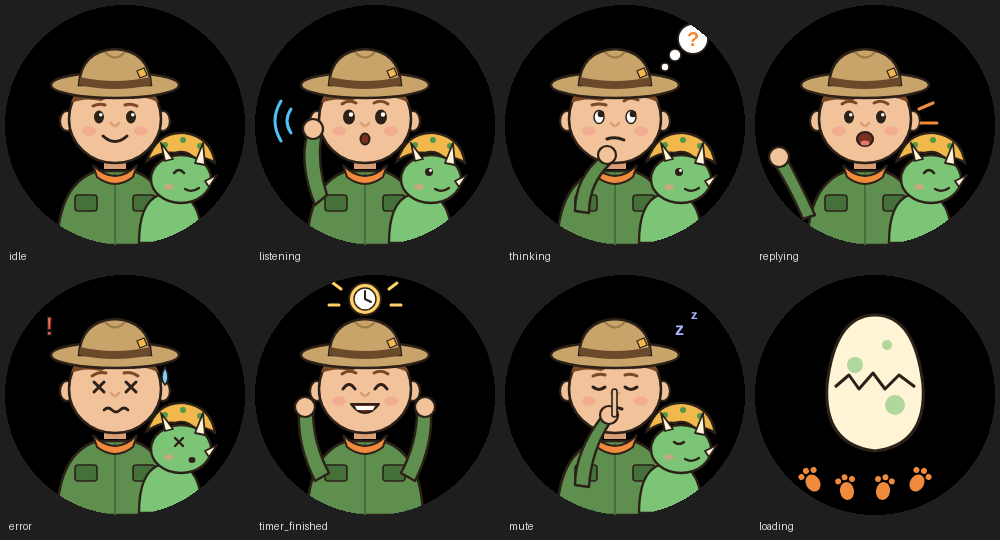
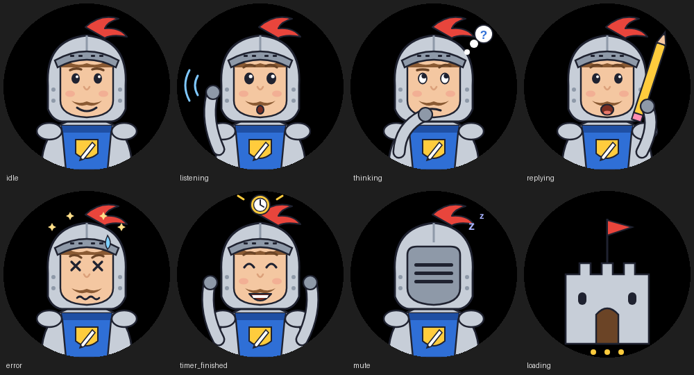
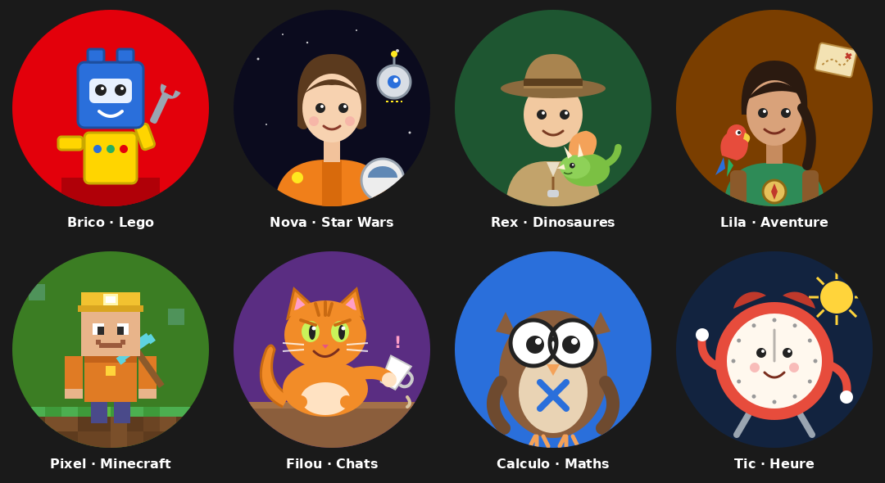

# Sphère AI – personnages

Images de personnages pour les sphères vocales ESPHome (Spotpear / Xiaozhi Ball v2, config RealDeco).

## Personnages

| Personnage | Aperçu |
|---|---|
| **MaxDresseur** : Max, soigneur au Parc des Géants, et Pico, son bébé tricératops (personnages originaux) |  |
| **Gaspard** : Sire Gaspard, chevalier des devoirs, armé de son crayon-épée (personnage original) |  |

## Personnages des pages (sphères tactiles)

Illustrations des pages de la sphère tactile (une par page), personnages originaux. Contrairement aux personnages d'état, elles ont un fond plein de la couleur de leur page.

| Fichier | Personnage | Page |
|---|---|---|
| `brico.png` | Brico, robot en briques | Histoire Lego |
| `nova.png` | Capitaine Nova et son droïde | Histoire Star Wars |
| `rex.png` | Rex le dresseur et son bébé tricératops | Histoire Dinosaures |
| `lila.png` | Lila l'exploratrice et son perroquet | Histoire Aventure |
| `pixel.png` | Pixel, mineur en blocs | Histoire Minecraft |
| `filou.png` | Filou, chat roux farceur | Histoire Chats farceurs |
| `calculo.png` | Calculo, hibou à lunettes | Défi maths |
| `tic.png` | Tic, le réveil | Heure |



URL : `https://github.com/Johan854/sphere-ai-images/raw/main/images/Pages/240x240/<fichier>.png`. Sources SVG dans `sources/Pages/` (`generer.py` régénère les SVG).

## Structure

```
images/<Personnage>/240x240/
  idle.png  listening.png  thinking.png  replying.png
  error.png  timer_finished.png  mute.png  loading.png
```

Chaque image fait 240×240 px, fond transparent. L'écran est rond : garder l'essentiel dans le cercle central.

## Utilisation dans la config ESPHome

```yaml
substitutions:
  image_repo: "Johan854/sphere-ai-images"   # ou "RealDeco/xiaozhi-esphome" pour les personnages d'origine
  imagemodel: "MaxDresseur"
```

Les URL des images utilisent `https://github.com/${image_repo}/raw/main/images/${imagemodel}/240x240/<état>.png`.

## Ajouter un personnage

Créer `images/<NomDuPersonnage>/240x240/` avec les 8 PNG ci-dessus, puis changer `imagemodel`. Les sources vectorielles sont dans `sources/<Personnage>/` (`generer.py` régénère les SVG).
